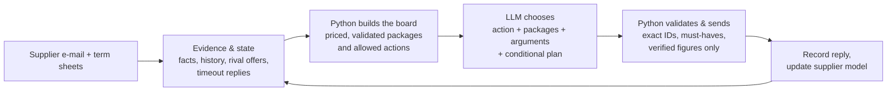

# += Tacto Negotiation Arena

**Autonomous procurement agent for Hollerau Pumpenwerke** · EHL Munich 2026 · team **+=**
([ziminaksu](https://github.com/ziminaksu), [IlyaKats2005](https://github.com/IlyaKats2005))

The agent negotiates by e-mail with supplier bots and closes the deal that minimises the buyer's
**total cost**: price, uncovered demand, payment terms, freight, lateness, quality, index clauses and,
where the category goal asks for it, the cost of squeezing a supplier below a sustainable margin.

| | |
|---|---|
| Practice leaderboard (best per case) | **0.808** mean over the 10 hosted cases, 10/10 deals |
| Last full rounds | **every session ends in a deal** – crashes, timeouts and lost moves were the main loss in earlier rounds |
| Decision model | **gpt-5-mini** (Azure OpenAI), automatic backups: gpt-oss-120b / DeepSeek-V4.1 (Hugging Face), Gemini |
| Live Final launcher | `./tools/final_azure.sh` – tested with 10 parallel sessions (one wave in 5.5 min of 8) |

## How a move is made



**Code computes, the model decides, code checks.** Python prices every package with the published cost
function (`arena_kit/cost.py`), removes options that break must-haves or our negotiation rules, and offers
the model a menu. The model picks the move, the arguments (each a checked data ID) and writes the e-mail.
Nothing the model writes can introduce a number that is not on the board.

### Negotiation rules that the board enforces (each came from a traced loss)

| Rule | Why |
|---|---|
| Open deep and from our own data (86 % of the ask or our order/current prices; 96-98 % when the goal is `stabilise`/`secure_supply`) | supplier concessions follow the anchor; with a margin penalty, deep cuts cost more than they save |
| Concession schedule: a quarter of the gap, then a third, then half | crawling steps make suppliers send a final offer early |
| Longest contract that covers the horizon | a commitment beyond the horizon is free for us and valuable to the supplier |
| RFQ: every supplier hears from us before we close; no counter after a supplier's own 5 % step; accept only within 1 % of the cheapest live offer | competition is the lever; a push after a big step made suppliers walk |
| RFQ: refresh all threads before each move; a supplier answered by timeout moves first | while one supplier answers (≈1 min), the others time out and change or withdraw their offers |
| Chargebacks only when the supplier's real defect rate makes them worth it; no index clause whose deadband is below the expected index move | both are priced into total cost, not just price |
| No counter after two "agreed" replies; no bare e-mail without a package while rivals are live | both burned moves or made suppliers walk |

## Reliability

A case that crashes scores 0, so the runner is built to never lose a case to one bad move:

- **Model chain with time budget:** primary model gets the time a reasoning model needs; on 429/503/timeout
  or an unparsable answer the next model answers (Hugging Face, then Gemini).
- **Every failed turn becomes a fallback move** taken from the current board (all rules still apply),
  never silence; learning errors are logged, not raised.
- **Runner hardening:** stale offer IDs are re-checked, a failed decision waits for the arena's timeout
  reply and decides again, malformed decisions fall back to the safest closing move, attachments and
  refreshes cannot crash a case. Code reviewed by two external models (DeepSeek-V4.1, gpt-oss-120b).
- **Deadlines:** one monotonic 55 s budget per move (arena limit 60 s), cancellable HTTP requests,
  `caffeinate` so a sleeping laptop cannot freeze a session.

## Results

Best practice score per case (score = share of the possible cost improvement captured, 1.0 = arena optimum):

| P01 | P02 | P03 | P04 | P05 | P07 | P08 | P10 | P11 | P18 | **Mean** |
|---:|---:|---:|---:|---:|---:|---:|---:|---:|---:|---:|
| 0.957 | 0.735 | 0.974 | 0.860 | 0.875 | 0.779 | 0.770 | 0.686 | 0.794 | 0.654 | **0.808** |

Honest limits: suppliers are LLM bots and vary between sessions (their opening price alone moves the score
by ±0.1-0.2), so single runs are noisy. P10's supplier sends its final offer after our second counter however
low we open (three models and a scripted probe agree), P02 needs the index clause the supplier values.
Every batch, including failures, is reported in [`docs/evaluation/`](docs/evaluation/).

## Run it

Python 3.12 and [uv](https://docs.astral.sh/uv/).

```bash
uv sync --all-extras
cp -n .env.example .env        # fill in ARENA_API_KEY and the model keys; .env is git-ignored
uv run arena data              # case data package
```

| Command | What it does |
|---|---|
| `./tools/run_azure.sh P05` | one practice case with gpt-5-mini (+ backups) |
| `./tools/run_free.sh P05` | one practice case on free Gemini (+ Hugging Face backup) |
| `./tools/final_azure.sh` | **Live Final**: all five waves, 10 parallel sessions, log in `hollerau/logs/` |
| `uv run pytest -q` | tests (16 legacy tests from the strict no-fallback design are known to fail) |

## Repository map

| Path | Content |
|---|---|
| `hollerau/analytical/` | the agent: `director.py` (board, rules, execution), `router.py` (model calls), `agent.py` (turn loop, fallbacks), `playbook.py`, `decision_record.py`, `budget.py` |
| `hollerau/intel.py` | verified arguments from the data package (indices, PO history, should-cost, delivery, quality) |
| `arena_kit/` | arena protocol, runner (`play.py`) and the published cost function |
| `tools/` | launchers and the scripted probe used to map supplier behaviour |
| `docs/` | [architecture](docs/CURRENT_ARCHITECTURE.md), [decision contract](docs/DECISION_CONTRACT.md), [evaluations](docs/evaluation/), [history](docs/history/) |
| `brief/` | the challenge brief and API |

## Publishing with Entire

Entire is enabled with `git-refs` checkpoints and telemetry disabled; agent sessions are attached as
scoped records without credentials. See the [EHL Entire instructions](https://hack.entire.io/ehl-munich-2026/).

Starter-kit code: `LICENSE-kit` (MIT). Data: `LICENSE-data` (CC BY 4.0).
