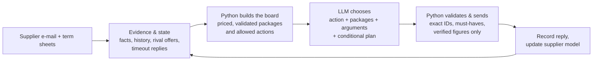

# += Tacto Negotiation Arena

**Autonomous procurement agent for Hollerau Pumpenwerke** · EHL Munich 2026 · team **+=**
([ziminaksu](https://github.com/ziminaksu), [IlyaKats2005](https://github.com/IlyaKats2005))

The agent negotiates by e-mail with supplier bots and aims to close a deal that reduces the buyer's
**total cost**: price, uncovered demand, payment terms, freight, lateness, quality, index clauses and,
where the category goal asks for it, the cost of squeezing a supplier below a sustainable margin.

| | |
|---|---|
| Historical best per case (reported, mixed versions) | **0.808** mean over 10 cases; not a matched evaluation of current code |
| Latest recorded full Azure batch | **0.624269** mean, **9/10 deals**; P05 no deal ([record](docs/evaluation/azure-all-cases-20261011.md)) |
| Latest funded GPT-6 P18 | **0.466961**, below prior Azure P18 **0.508944**; **$0.499877** conservative whole-round spend ([record](docs/evaluation/budget-recovery-20261011.md)) |
| Ksu’s newer P18 result (reported in `6be741d`) | **0.721**; contract/note evidence integrated, not independently rerun here |
| Decision model | Azure launcher: **gpt-5-mini**, configured backups; capped OpenAI launcher: **gpt-6-astra**, no provider fallback |
| Live Final launcher | `./tools/final_azure.sh` – up to 10 parallel sessions; Azure costs are separate from the OpenAI spending ledger |

## How a move is made



**Code computes, the model decides, code checks.** Python prices every package with the published cost
function (`arena_kit/cost.py`), removes options that break must-haves or our negotiation rules, and offers
the model a menu. The model picks the move, the arguments (each a checked data ID) and writes the e-mail.
Nothing the model writes can introduce a number that is not on the board.

### Negotiation policies (heuristics from recorded runs, not universal supplier rules)

| Rule | Why |
|---|---|
| Open deep and from our own data (86 % of the ask or our order/current prices; 96-98 % when the goal is `stabilise`/`secure_supply`) | supplier concessions follow the anchor; with a margin penalty, deep cuts cost more than they save |
| Concession schedule: a quarter of the gap, then a third, then half | crawling steps make suppliers send a final offer early |
| Longest contract that covers the horizon | a commitment beyond the horizon is free for us and valuable to the supplier |
| RFQ: every supplier hears from us before we close; no counter after a supplier's own 5 % step; accept only within 1 % of the cheapest live offer | competition is the lever; a push after a big step made suppliers walk |
| RFQ: refresh changed threads concurrently within one six-second budget; prioritize timeout replies | closed or changed offers must not remain executable; reserve time for the decision |
| Chargebacks only when the supplier's real defect rate makes them worth it; no index clause whose deadband is below the expected index move | both are priced into total cost, not just price |
| No counter after two "agreed" replies; no bare e-mail without a package while rivals are live | both burned moves or made suppliers walk |

## Reliability

Ksu’s later closing guards stop bargaining after two agreements and prevent
walking away from a valid deal that beats the estimated outside option. When the
outside option is better, walking away remains possible. These are policy choices.

The runner bounds recovery and records failures explicitly. It cannot guarantee a deal:

- **Current offers:** changed supplier threads refresh concurrently within a shared total deadline.
  Known closures immediately remove old offers; unread changed offers are marked uncertain.
- **Decision contract:** early confirmation/acceptance must compare a currently available counter or
  useful question. A prior stop condition is advisory. Confirmation is explicitly nonbinding.
- **Faithful execution:** all approved packages and up to two selected evidence arguments are rendered;
  rejected renders restore pending state. Raw and normalized model output remain distinct in the audit.
- **Recovery:** provider fallbacks depend on the launcher and remaining deadline. In capped GPT-6 mode
  there is no secondary provider; exhausted spending closes a valid received offer when possible.
  This is recorded as a budget closure, not a model decision.
- **Spending:** the GPT-6 launcher shares an atomic SQLite allowance across cases and restarts, checks
  billing before opening Arena, and retains cost reservations after uncertain request failures.
- **Audit:** an authorized action, a send attempt and a confirmed send are separate events. Failed
  requests are not labelled as successful sends. Historical results retain their measured code version.


## Results

Historical best practice snapshot reported by the team before `6be741d`, across different runs and versions
(score = share of possible cost improvement captured, 1.0 = arena optimum):

| P01 | P02 | P03 | P04 | P05 | P07 | P08 | P10 | P11 | P18 | **Mean** |
|---:|---:|---:|---:|---:|---:|---:|---:|---:|---:|---:|
| 0.957 | 0.735 | 0.974 | 0.860 | 0.875 | 0.779 | 0.770 | 0.686 | 0.794 | 0.654 | **0.808** |

Supplier replies vary between sessions. Historical best-of-many scores are not evidence that the
current version will repeat them. The last complete batch had a failed deal, and the latest funded P18
run did not improve the previous score. The stability fixes added afterward have regression coverage,
not a new paid Arena evaluation. See [`docs/evaluation/`](docs/evaluation/) for versioned records.

## Run it

Python 3.12 and [uv](https://docs.astral.sh/uv/).

```bash
uv sync --all-extras
cp -n .env.example .env        # fill in ARENA_API_KEY and the model keys; .env is git-ignored
uv run arena data              # case data package
```

| Command | What it does |
|---|---|
| `./tools/run_azure.sh P05` | one practice case with gpt-5-mini (+ backups) |
| `./tools/run_free.sh P05` | one practice case on free Gemini (+ Hugging Face backup) |
| `./tools/final_azure.sh` | **Live Final**: all five waves, 10 parallel sessions, log in `hollerau/logs/` |
| `./tools/run_gpt6.sh P18` | direct GPT-6 with a shared $1 ledger by default; reuse the authorized round’s ledger |
| `uv run pytest -q` | full regression suite; hosted integration tests require separate explicit credentials |

## Repository map

| Path | Content |
|---|---|
| `hollerau/analytical/` | the agent: `director.py` (board, rules, execution), `router.py` (model calls), `agent.py` (turn loop, fallbacks), `playbook.py`, `decision_record.py`, `budget.py` |
| `hollerau/intel.py` | verified arguments from the data package (indices, PO history, should-cost, delivery, quality) |
| `arena_kit/` | arena protocol, runner (`play.py`) and the published cost function |
| `tools/` | launchers and the scripted probe used to map supplier behaviour |
| `docs/` | [architecture](docs/CURRENT_ARCHITECTURE.md), [decision contract](docs/DECISION_CONTRACT.md), [evaluations](docs/evaluation/), [history](docs/history/) |
| `brief/` | the challenge brief and API |

## Publishing with Entire

Entire is enabled with `git-refs` checkpoints and telemetry disabled; agent sessions are attached as
scoped records without credentials. See the [EHL Entire instructions](https://hack.entire.io/ehl-munich-2026/).

Starter-kit code: `LICENSE-kit` (MIT). Data: `LICENSE-data` (CC BY 4.0).
