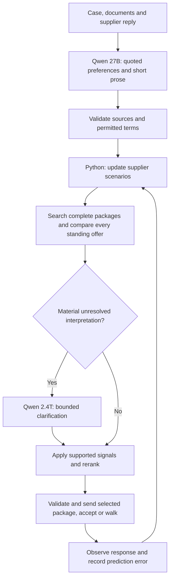

# Analytical buyer agent — bayes-v2.2 (integrated team version)

Python selects complete deals; Qwen extracts source-supported preferences before selection and supplies bounded prose. The original team agents remain available for comparison.

## Run and inspect

```sh
uv sync --all-extras --locked
# Configure ARENA_API_KEY, HF_TOKEN and ARENA_DATA in ignored .env.
uv run tacto-bayes --run-id my-five-case-experiment --max-sessions 5 \
  --cases case:P01 case:P04 case:P05 case:P10 case:P11
uv run python -m hollerau.analytical.report --run-id my-five-case-experiment
```

Each start is reserved in SQLite before HTTP. Unknown outcomes count; no automatic start retries or replacement sessions occur. Reusing the same run ID cannot exceed its cap or replay a case. Do not delete the database or switch IDs to circumvent an agreed limit. Results are stored per run; secrets, database and raw transcripts remain ignored.

The existing final runner can explicitly select this agent:

```sh
uv run python -m hollerau run --set final --brain analytical --parallel 10
```

That command is for the final and is not run by the practice experiment. The legacy CLI retains its own session behaviour; use `tacto-bayes` for bounded practice. The starter-kit wave-deadline closure remains its original implementation.

## Decision loop



Qwen never supplies numerical preference coefficients or acceptance probabilities. Exact quotes must match supplied sources; this verifies provenance, not the truth of a supplier claim. Signals are restricted to negotiable fields. A request for faster payment cannot reopen fixed payment terms. Attachments and recent correspondence are included, with bounded excerpt lengths.

## Supplier estimates and learning

Each supplier starts with 64 reproducible, weighted scenarios. Priors are modelling assumptions, not calibrated facts.

| Parameter | Meaning |
|---|---|
| `r` | Acceptance threshold in EUR/unit at reference terms; distinct from production cost |
| `b_pay` | Value of receiving payment 30 days earlier |
| `b_term` | Value of 12 extra contract months; can be negative |
| `b_flex` | Value of seven extra delivery days |
| `b_quality` | Cost of tightening the quality commitment by 1,000 ppm |
| `b_capacity` | Sensitivity to volume above the latest offered allocation |
| `full_cost` | Uncertain production cost used by the published sustainability penalty |

A source-backed preference weakly reweights scenarios, by at most a 2:1 likelihood ratio per statement, with duplicate suppression and at most two signals of each kind per session. Explicit long-commitment evidence permits a modest, assumed reduction of the capacity uplift penalty. None of this establishes a physical capacity limit or guarantees additional allocation.

Actual accept/counter/walk outcomes reweight scenarios with a tempered likelihood. A regularised online update adjusts walk intercept, pressure slope, repeat slope and acceptance bias. Prediction probabilities and multiclass Brier errors are logged. These updates make assumptions responsive; a few observations do not make them statistically calibrated.

`learned_models` stores normalised preference means and response estimates. Subsequent sessions blend 25% of an existing supplier estimate or 10% of a category estimate into new priors, preserving scenario spread. Only models with observed responses are reused. Current production costs and capacities are not copied between suppliers. Known buyer costs for quality, delivery and financing come directly from the case; they are not replaced by invented learned weights. No Qwen weights are trained.

## Offer search and closure

Enumerate reference and one-field changes plus up to 600 complete packages from the starter kit. Search a price grid from 20% below to 15% above the current quote, with additional prices derived from estimated supplier value and a concession increment. Prices remain within a bounded exploration range. Premiums can buy better non-price terms. This is a bounded heuristic, not a global optimiser.

Evaluate every candidate when there are at most 1,200. Above that, retain central expected-value candidates, cheap candidates, high-acceptance candidates and representatives across packages. The initial v2 pruning experiment missed useful intermediate prices; this broader selection fixed the observed local regression before hosted testing.

After a counteroffer, require a meaningful improvement in estimated supplier package value. Track unchanged supplier responses and include a small cost for another stalled round. Compare quoted packages across live suppliers, but distinguish indicative alternatives from executable standing offers. Arena can return additional sheets whose IDs cannot be accepted. Only the registered standing sheet (first in the message API) is eligible for acceptance; alternatives still inform counteroffer search. The bounded runner confirms the standing ID with the server immediately before accepting. An ID change aborts that acceptance rather than silently choosing different terms. A closing thread does not force closure while other suppliers remain negotiable.

The objective is expected deal/counter/fallback cost plus 0.25 times the standard deviation of scenario expected costs. It uses the official full-cost function, including the uncertain sustainability term. The 0.25 risk preference and round cost remain explicit assumptions. Fallback expenditure without a qualified alternative is a risk proxy, not guaranteed supply. Report the actual Arena score separately.

## Qwen routing and latency

Defaults: `Qwen/Qwen3.8-27B:deepinfra` and `Qwen/Qwen3.8-2.4T-A95B:deepinfra`, overridable in `.env`.

One small-model call provides both interpretations and short non-binding prose. Identical source/context inputs reuse a cached analysis. A large-model call requires unresolved interpretation with material scenario regret, or failed analysis in an infeasible capacity case. Mere disagreement between numerical scenarios does not automatically invoke it. Two consecutive large-model failures open a circuit for the current runner. The large model uses low reasoning effort.

HTTP calls have a 12-second timeout and share the decision's 40-second budget. Calculations also consume wall time. HTTP read timeouts may still incur charges. Returned usage is not a complete invoice. On failure the code uses existing uncertain beliefs and a deterministic message. No extra writer call is required. Exact term sheets and verified factual arguments are appended by code after prose validation.

## Validation and limitations

`uv run pytest -q` covers source validation, fixed-term handling, causal evidence-before-ranking order, indicative-versus-standing selection, closing preflight, counteroffer progression, persisted learning, caching, escalation circuits, quota reservation and valid local games. Optional hosted tests remain skipped unless explicitly configured.

The offline baseline comparison uses identical simulator cases and seeds with models disabled. It tests decision mechanics; it does not reproduce the hosted supplier or validate Qwen extraction. Hosted comparisons use the same five case IDs but different stochastic supplier sessions. Several changes ship together, so score differences cannot identify which component caused them. The second batch encountered an HTTP 422 when accepting an indicative P10 alternative. P10 was recovered on its registered offer without opening another session. The v2.1 closing guard was added before P11; the report marks this intervention rather than presenting all five as uninterrupted autonomous runs. Historical architecture v3 images represent the earlier proposal; the flow above describes the current implementation.

## Entire provenance

Repository hooks are enabled, but this desktop session is outside their checkout scope. The supported external-agent import attaches genuine scoped Codex records using `tools/export_codex_session.py` and `tools/entire-agent-codex-export`. No synthetic conversation is created. Earlier unrelated history, internal context, image pixels and credentials are omitted. Original timestamps and record hashes are preserved. A scoped import identifier may distinguish successive implementation segments of the same original session; the manifest records its source session.

Keep `.entire/settings.local.json` and `.entire/tmp/` untracked. Verify the commit trailer and remote checkpoint ref after pushing. Enabling hooks alone is not evidence of capture.

## Concurrent team changes integrated after the five runs

The remote branch gained supplier-informed priors, compliant-supplier prioritisation, coverage-preserving search and optional OpenAI support during this experiment. They are retained in v2.2, with the new interpretation-before-selection pipeline. These combined changes were locally tested after merging, but **were not run in an additional hosted session**. The published five-run scores belong to v2/v2.1, not v2.2.

Dossier flags influence initial, uncalibrated ranges: cash stress widens payment value, partnership cues favour longer terms, spare capacity reduces capacity resistance, and approval steps increase pressure/repetition sensitivity. Scenario uncertainty and cautious posterior updates remain. The online response estimates shrink toward these supplier-conditioned priors. Compliant, lower-cost suppliers receive priority among threads that can still negotiate; a terminal thread does not close other actionable negotiations.

For the optional OpenAI route, configure `LLM_PROVIDER=openai`, `LLM_API_KEY`, and optionally `LLM_BASE_URL`, `ANALYTICAL_SMALL_MODEL` and `ANALYTICAL_LARGE_MODEL`. Defaults are `gpt-4.1-mini` for both stages; when the IDs match no duplicate escalation call is made. Qwen-specific request fields are omitted on this route. Mock tests verify this integration without spending API credits. To select the originally requested Hugging Face Qwens explicitly, set `LLM_PROVIDER=hf` and `HF_TOKEN`.
