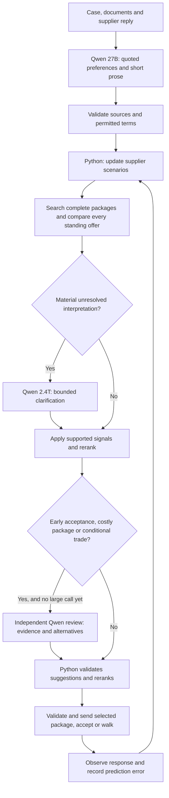

# Analytical buyer agent — bayes-v4-private

Python selects complete deals; Qwen extracts source-supported preferences before selection and supplies bounded prose. A selective independent reviewer can propose corrections, which Python validates and evaluates again. The original team agents remain available for comparison. This revision is local and has not been published or tested on Arena.

## Run and inspect

```sh
uv sync --all-extras --locked
# Configure ARENA_API_KEY, HF_TOKEN and ARENA_DATA in ignored .env.
uv run tacto-bayes --run-id my-five-case-experiment --max-sessions 5 \
  --cases case:P01 case:P04 case:P05 case:P10 case:P11
uv run python -m hollerau.analytical.report --run-id my-five-case-experiment
```

Each start is reserved in SQLite before HTTP. Unknown outcomes count; no automatic start retries or replacement sessions occur. Reusing the same run ID cannot exceed its cap or replay a case. Do not delete the database or switch IDs to circumvent an agreed limit. Results are stored per run; secrets, database and raw transcripts remain ignored.

The existing final runner can explicitly select this agent:

```sh
uv run python -m hollerau run --set final --brain analytical --parallel 10
```

That command is for the final and is not run by the practice experiment. The legacy CLI retains its own session behaviour; use `tacto-bayes` for bounded practice. The starter-kit wave-deadline closure remains its original implementation.

## Decision loop



Qwen never supplies numerical preference coefficients or acceptance probabilities. Exact quotes must match supplied sources; this verifies provenance, not the truth of a supplier claim. Signals are restricted to negotiable fields. A request for faster payment cannot reopen fixed payment terms. Attachments and recent correspondence are included, with bounded excerpt lengths.

## Supplier estimates and learning

Each supplier starts with 64 reproducible, weighted scenarios. Priors are modelling assumptions, not calibrated facts.

| Parameter | Meaning |
|---|---|
| `r` | Acceptance threshold in EUR/unit at reference terms; distinct from production cost |
| `b_pay` | Value of receiving payment 30 days earlier |
| `b_term` | Value of 12 extra contract months; can be negative |
| `b_flex` | Value of seven extra delivery days |
| `b_quality` | Cost of tightening the quality commitment by 1,000 ppm |
| `b_capacity` | Sensitivity to volume above the latest offered allocation |
| `b_index` | Value of index protection, coupled to duration and material share |
| `b_volume` | Value of additional volume committed over the contract duration |
| `full_cost` | Uncertain production cost used by the published sustainability penalty |

A source-backed preference weakly reweights scenarios, by at most a 2:1 likelihood ratio per statement, with duplicate suppression and at most two signals of each kind per session. Explicit long-commitment evidence permits a modest, assumed reduction of the capacity uplift penalty. None of this establishes a physical capacity limit or guarantees additional allocation.

Actual accept/counter/walk outcomes reweight scenarios with a tempered likelihood. A regularised online update adjusts walk intercept, pressure slope, repeat slope and acceptance bias. Prediction probabilities and multiclass Brier errors are logged. These updates make assumptions responsive; a few observations do not make them statistically calibrated.

Numeric counteroffers also update the estimated concession rate and package preferences. A supplier's executable quote bounds its reservation value from above, not below: asking for EUR 100 does not mean EUR 100 is its minimum. Production-cost assumptions inconsistent with repeated quotes are weakly downweighted; loss-making offers remain possible. Duplicate observations are suppressed.

Conditional preferences preserve statements such as “24 months requires an index clause” as a linked pair of terms. They reduce estimated acceptance of violating packages without becoming hard buyer constraints. They require source quotes and permitted fields/values. A small offline extractor handles explicit index-duration statements; otherwise Qwen supplies the interpretation. A later supplier offer can contradict and remove an earlier condition.

`learned_models` stores normalised preference means and response estimates. Subsequent sessions blend 25% of an existing supplier estimate or 10% of a category estimate into new priors, preserving scenario spread. Only models with observed responses are reused. Current production costs and capacities are not copied between suppliers. Known buyer costs for quality, delivery and financing come directly from the case; they are not replaced by invented learned weights. No Qwen weights are trained.

## Offer search and closure

Enumerate reference and one-field changes plus up to 600 complete packages from the starter kit. Search a price grid from 20% below to 15% above the current quote, with additional prices derived from estimated supplier value and a concession increment. Prices remain within a bounded exploration range. Premiums can buy better non-price terms. This is a bounded heuristic, not a global optimiser.

Evaluate every candidate when there are at most 1,200. Above that, retain central expected-value candidates, cheap candidates, high-acceptance candidates and representatives across packages. The initial v2 pruning experiment missed useful intermediate prices; this broader selection fixed the observed local regression before hosted testing.

After a counteroffer, require a meaningful improvement in estimated supplier package value. Track unchanged supplier responses and include a small cost for another stalled round. Compare quoted packages across live suppliers, but distinguish indicative alternatives from executable standing offers. Arena can return additional sheets whose IDs cannot be accepted. Only the registered standing sheet (first in the message API) is eligible for acceptance; alternatives still inform counteroffer search. The bounded runner confirms the standing ID with the server immediately before accepting. An ID change aborts that acceptance rather than silently choosing different terms. A closing thread does not force closure while other suppliers remain negotiable.

The objective is expected deal/counter/fallback cost plus 0.25 times the standard deviation of its difference from a common standing-offer reference. For comparisons within one supplier, shared uncertainty therefore cancels instead of discouraging negotiation by itself. Cross-supplier comparisons still use a point estimate for the other supplier and need further work. Costs use the published full-cost function, including the uncertain sustainability term. The 0.25 risk preference and round cost remain explicit assumptions. Fallback expenditure without a qualified alternative is a risk proxy, not guaranteed supply. Report the actual Arena score separately.

When more than two moves remain, Python screens every candidate against a central continuation forecast before evaluating a shortlist across all belief particles. The forecast spans at most four supplier replies, averages three concession scenarios, and allows acceptance after each reply. Further negotiation pays for its own estimated walk risk and round cost. The agent replans after the actual reply; it does not assume that an old quote will survive a counteroffer. Reservation value and immediate willingness to accept are separate estimates. This remains an approximate forecast, not a calibrated opponent simulator or a complete value-of-information optimiser.

The reservation prior now retains lower-floor hypotheses rather than excluding them with a narrow quote-derived range. The thirty-day payment coefficient is converted from an annual financing-rate prior (upper rate 30% for cash stress, otherwise 18%). These are modelling assumptions, not learned facts. Pressure uses estimated package value rather than the sticker-price discount alone.

In an RFQ, an executable rival quote backs the risk of negotiating with another supplier. Threads receive initial attention in contact-count order; an unpromising thread is parked before considering closure. A parked quote remains eligible for acceptance. The same overall decision deadline applies when considering another thread.

An opening can include one additional package at comparable expected buyer cost, if uncertain supplier preferences make the choice informative. Both packages preserve hard constraints, and adverse differences in relationship cost are bounded. An unambiguous echo of one package updates preference beliefs softly. Subsequent package switches must improve supplier value in at least 90% of the current scenario weight, avoiding accidental reversals caused by trading against a mean preference estimate. The opening-menu feature is heuristic and requires separate validation; the forecaster still primarily evaluates the selected main package.

## Qwen routing and latency

Defaults: `Qwen/Qwen3.8-27B:deepinfra` and `Qwen/Qwen3.8-2.4T-A95B:deepinfra`, overridable in `.env`.

One small-model call provides both interpretations and short non-binding prose. Identical source/context inputs reuse a cached analysis. A large-model call can resolve material interpretation uncertainty or independently review early acceptance, an expensive package, a conditional trade, or an opening quality concession. The reviewer receives source evidence, permitted terms, cost breakdowns and candidate packages, without the first model's rationale. It can supply sourced conditions and up to three alternatives. Python checks fixed terms, allowed values, bounded prices and concession progression before reranking. At most one large-model call occurs per decision, shared between clarification and review. Two consecutive failures open a circuit for the current runner. The large model uses low reasoning effort.

HTTP calls have a 12-second timeout and share the decision's 40-second budget. Calculations also consume wall time. HTTP read timeouts may still incur charges. Returned usage is not a complete invoice. On failure the code uses existing uncertain beliefs and a deterministic message. No extra writer call is required. Exact term sheets and verified factual arguments are appended by code after prose validation.

### Independent Astra reviewer

To keep Qwen interpretation and use Astra for the strategic review, configure the ignored `.env`:

```dotenv
LLM_PROVIDER=hf
STRATEGIC_REVIEWER=astra
OPENAI_API_KEY=<your OpenAI project API key>
```

This selects `gpt-6-astra` through the OpenAI Responses API; HF credentials are never sent to OpenAI. The existing Qwen models still handle interpretation and material-ambiguity escalation. Set `STRATEGIC_REVIEWER=primary` to restore the configured large model as reviewer. Astra uses medium reasoning, a maximum of 4,096 combined reasoning/output tokens, a 20-second request timeout and three seconds reserved for Python to finish. It shares the 40-second decision budget and the one-large-call-per-turn limit, so a prior ambiguity escalation can skip review. Responses are requested with `store=false`; this does not imply zero provider retention.

Only a complete, parsed response with valid source quotes reaches the existing condition and candidate checks. Missing credentials, refusal, truncation, timeout or invalid output leave the Python plan intact. Two failed Astra reviews disable further attempts for that router instance without disabling Qwen. There are no automatic retries. `--offline-llm` disables both providers. Mock tests check separate credentials/endpoints, Responses parsing, caching and failures; live access and quality require a separate private check after configuring the key.

## Validation and limitations

`uv run pytest -q` covers source validation, fixed-term handling, causal evidence-before-ranking order, indicative-versus-standing selection, closing preflight, counteroffer progression, persisted learning, caching, escalation circuits, quota reservation and valid local games. Optional hosted tests remain skipped unless explicitly configured.

The private v3 evaluation compares against the preceding commit using matched opponent seeds and fresh learning memory for every game. Development comparisons and a separate held-out evaluation are retained under ignored `hollerau/logs/private-v3/`. Network calls are disabled. Tests also cover conditional terms, paired uncertainty, numeric learning, and mocked reviewer integration. These results do not establish an Arena improvement or validate a live reviewer's judgement.

The private v4 work uses the current private v3 implementation as its frozen baseline. Earlier inspected cases are development data. Its target is a mean score of at least 0.90 on a separately generated evaluation set; the gate also requires valid actions and reports every zero and regression. The simulator, opponents and score function are unchanged. No hidden supplier parameters enter the buyer. Full results and source fingerprints remain under ignored `hollerau/logs/private-v4/`; a development score alone does not pass this gate. Qwen and Astra are disabled in these score experiments, which measure the Python decision policy only.

The final frozen candidate scored 0.90094 on nine development games, versus 0.73685 for private v3. On 45 fresh games (15 case configurations, three new opponent seeds each), it scored 0.77556 versus 0.57688: 38 improvements, seven ties, no regressions, 45 valid deals and no supplier walkouts. Only seven of those fresh scores reached 0.90; the minimum was 0.45179. The fresh-evaluation gate therefore **failed**. Each game starts with empty learning memory, so this does not test transfer across sessions. Validation: 87 tests passed, one optional hosted test skipped, lint and whitespace checks passed. No Arena sessions, model calls, commits or pushes were made for this evaluation. The machine-readable record is `hollerau/logs/private-v4/summary.json`; the frozen source fingerprint is recorded there and in `freeze.json`.

The offline baseline comparison uses identical simulator cases and seeds with models disabled. It tests decision mechanics; it does not reproduce the hosted supplier or validate Qwen extraction. Hosted comparisons use the same five case IDs but different stochastic supplier sessions. Several changes ship together, so score differences cannot identify which component caused them. The second batch encountered an HTTP 422 when accepting an indicative P10 alternative. P10 was recovered on its registered offer without opening another session. The v2.1 closing guard was added before P11; the report marks this intervention rather than presenting all five as uninterrupted autonomous runs. Historical architecture v3 images represent the earlier proposal; the flow above describes the current implementation.

## Entire provenance

Repository hooks are enabled, but this desktop session is outside their checkout scope. The supported external-agent import attaches genuine scoped Codex records using `tools/export_codex_session.py` and `tools/entire-agent-codex-export`. No synthetic conversation is created. Earlier unrelated history, internal context, image pixels and credentials are omitted. Original timestamps and record hashes are preserved. A scoped import identifier may distinguish successive implementation segments of the same original session; the manifest records its source session.

Keep `.entire/settings.local.json` and `.entire/tmp/` untracked. Verify the commit trailer and remote checkpoint ref after pushing. Enabling hooks alone is not evidence of capture.

## Concurrent team changes integrated after the five runs

The remote branch gained supplier-informed priors, compliant-supplier prioritisation, coverage-preserving search and optional OpenAI support during the earlier experiment. They were integrated in v2.2 with interpretation before selection and are retained here. The original five-run comparison belongs to v2/v2.1; the later remaining-supplier coverage batch tested v2.2. Neither report measures the private v3 changes.

Dossier flags influence initial, uncalibrated ranges: cash stress widens payment value, partnership cues favour longer terms, spare capacity reduces capacity resistance, and approval steps increase pressure/repetition sensitivity. Scenario uncertainty and cautious posterior updates remain. The online response estimates shrink toward these supplier-conditioned priors. Compliant, lower-cost suppliers receive priority among threads that can still negotiate; a terminal thread does not close other actionable negotiations.

For the optional OpenAI route, configure `LLM_PROVIDER=openai`, `LLM_API_KEY`, and optionally `LLM_BASE_URL`, `ANALYTICAL_SMALL_MODEL` and `ANALYTICAL_LARGE_MODEL`. Defaults are `gpt-4.1-mini` for both stages; when the IDs match no duplicate escalation call is made. Qwen-specific request fields are omitted on this route. Mock tests verify this integration without spending API credits. To select the originally requested Hugging Face Qwens explicitly, set `LLM_PROVIDER=hf` and `HF_TOKEN`.
