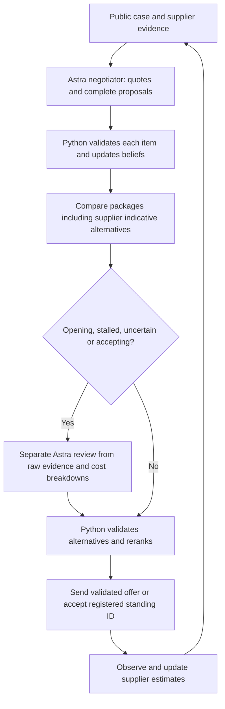

# Analytical buyer agent — bayes-v5-astra

Astra proposes complete deals and a separate Astra call reviews difficult decisions. Python owns cost calculations, probability updates, permitted terms and final actions. Legacy Qwen routing remains explicitly selectable. Historical evaluations below retain their original policy labels.

## Run and inspect

Configure `ARENA_API_KEY`, `ARENA_DATA` and `OPENAI_API_KEY` in ignored `.env`:

```sh
uv run tacto-bayes --primary astra --reviewer astra \
  --run-id my-two-case-experiment --max-sessions 2 --cases case:P02 case:P18
uv run python -m hollerau.analytical.report --run-id my-two-case-experiment
```

The requested v5 experiment authorises only one new session each on P02 and P18. SQLite reserves starts before HTTP; failed or ambiguous starts still count. Do not change the run ID or database to bypass a cap. There are no automatic replacements. Saved-input replays use these same two cases without calling Arena.

## Decision loop



Both roles use `gpt-6-astra`, with separate requests and no shared model conversation or negotiator rationale passed to the reviewer. Agreement between them is not proof of correctness. Strict, case-specific structured outputs constrain fields; Python still validates exact quotes, options, fixed terms, numerical bounds and must-haves. One unsupported item is rejected and logged without discarding independently valid proposals. A supplier welcoming our terms is not evidence that those terms are required. The explicit-requirement gate is conservative and does not prove general semantic entailment.

## Supplier estimates and learning

Each supplier starts with 64 reproducible, weighted scenarios. Priors are modelling assumptions, not calibrated facts.

| Parameter | Meaning |
|---|---|
| `r` | Acceptance threshold in EUR/unit at reference terms; distinct from production cost |
| `b_pay` | Value of receiving payment 30 days earlier |
| `b_term` | Value of 12 extra contract months; can be negative |
| `b_flex` | Value of seven extra delivery days |
| `b_quality` | Cost of tightening the quality commitment by 1,000 ppm |
| `b_capacity` | Sensitivity to volume above the latest offered allocation |
| `b_index` | Value of index protection, coupled to duration and material share |
| `b_volume` | Value of additional volume committed over the contract duration |
| `full_cost` | Uncertain production cost used by the published sustainability penalty |

A source-backed preference weakly reweights scenarios, by at most a 2:1 likelihood ratio per statement, with duplicate suppression and at most two signals of each kind per session. Explicit long-commitment evidence permits a modest, assumed reduction of the capacity uplift penalty. None of this establishes a physical capacity limit or guarantees additional allocation.

Actual accept/counter/walk outcomes reweight scenarios with a tempered likelihood. A regularised online update adjusts walk intercept, pressure slope, repeat slope and acceptance bias. Prediction probabilities and multiclass Brier errors are logged. These updates make assumptions responsive; a few observations do not make them statistically calibrated.

Numeric counteroffers also update the estimated concession rate and package preferences. A supplier's executable quote bounds its reservation value from above, not below: asking for EUR 100 does not mean EUR 100 is its minimum. Production-cost assumptions inconsistent with repeated quotes are weakly downweighted; loss-making offers remain possible. Duplicate observations are suppressed.

Conditional preferences preserve statements such as “24 months requires an index clause” as a linked pair of terms. They reduce estimated acceptance of violating packages without becoming hard buyer constraints. They require source quotes and permitted fields/values. A small offline extractor handles explicit index-duration statements; otherwise Astra supplies the interpretation. A later supplier offer can contradict and remove an earlier condition.

`learned_models` stores normalised preference means and response estimates. Subsequent sessions blend 25% of an existing supplier estimate or 10% of a category estimate into new priors, preserving scenario spread. Only models with observed responses are reused. Current production costs and capacities are not copied between suppliers. Known buyer costs for quality, delivery and financing come directly from the case; they are not replaced by invented learned weights. No model weights are trained.

## Offer search and closure

Enumerate reference and one-field changes plus up to 600 complete packages from the starter kit. Search a price grid from 20% below to 15% above the current quote, with additional prices derived from estimated supplier value and a concession increment. Prices remain within a bounded exploration range. Premiums can buy better non-price terms. This is a bounded heuristic, not a global optimiser.

Evaluate every candidate when there are at most 1,200. Above that, retain central expected-value candidates, cheap candidates, high-acceptance candidates and representatives across packages. The initial v2 pruning experiment missed useful intermediate prices; this broader selection fixed the observed local regression before hosted testing.

After a counteroffer, require progress for an unchanged package; allow different packages to compete under uncertainty instead of discarding them with a 90% scenario threshold. Track unchanged supplier responses and include a small cost for another stalled round. Compare quoted packages across live suppliers, but distinguish indicative alternatives from executable standing offers. Arena can return additional sheets whose IDs cannot be accepted. Only the registered standing sheet (first in the message API) is eligible for acceptance; valid complete alternatives enter search at their quoted price and can be re-proposed for confirmation. The bounded runner confirms the standing ID with the server immediately before accepting. An ID change aborts that acceptance rather than silently choosing different terms. A closing thread does not force closure while other suppliers remain negotiable.

The objective is expected deal/counter/fallback cost plus 0.25 times the standard deviation of its difference from a common standing-offer reference. For comparisons within one supplier, shared uncertainty therefore cancels instead of discouraging negotiation by itself. Cross-supplier comparisons still use a point estimate for the other supplier and need further work. Costs use the published full-cost function, including the uncertain sustainability term. The 0.25 risk preference and round cost remain explicit assumptions. Fallback expenditure without a qualified alternative is a risk proxy, not guaranteed supply. Report the actual Arena score separately.

When more than two moves remain, Python screens every candidate against a central continuation forecast before evaluating a shortlist across all belief particles. The forecast spans at most four supplier replies, averages three concession scenarios, and allows acceptance after each reply. Further negotiation pays for its own estimated walk risk and round cost. The agent replans after the actual reply; it does not assume that an old quote will survive a counteroffer. Reservation value and immediate willingness to accept are separate estimates. This remains an approximate forecast, not a calibrated opponent simulator or a complete value-of-information optimiser.

The reservation prior now retains lower-floor hypotheses rather than excluding them with a narrow quote-derived range. The thirty-day payment coefficient is converted from an annual financing-rate prior (upper rate 30% for cash stress, otherwise 18%). These are modelling assumptions, not learned facts. Pressure uses estimated package value rather than the sticker-price discount alone.

In an RFQ, an executable rival quote backs the risk of negotiating with another supplier. Threads receive initial attention in contact-count order; an unpromising thread is parked before considering closure. A parked quote remains eligible for acceptance. The same overall decision deadline applies when considering another thread.

An opening can include one additional package at comparable expected buyer cost, if uncertain supplier preferences make the choice informative. Both packages preserve hard constraints, and adverse differences in relationship cost are bounded. An unambiguous echo of one package updates preference beliefs softly. Subsequent package switches remain available and their estimated response risk is evaluated. The opening-menu feature is heuristic and requires separate validation; the forecaster still primarily evaluates the selected main package.

## Astra routing and latency

`ANALYTICAL_PRIMARY=astra` and `STRATEGIC_REVIEWER=astra` are the defaults. `OPENAI_API_KEY` is the only key used by those calls. The Responses API uses medium reasoning, up to 4096 reasoning/output tokens, `store=false` and a strict case-specific JSON schema. See [official structured-output documentation](https://developers.openai.com/api/docs/guides/structured-outputs).

The primary call is bounded to 22 seconds, the reviewer to 25; both share a 52-second decision deadline with three seconds reserved at each call for local processing. The Arena move limit is 60 seconds. There are no retries; failures keep the Python fallback available and are recorded by role, error class and validation section. Two consecutive failed reviewer calls open its circuit. No extra writing call is needed. Returned token usage does not capture billing for timed-out calls.

The reviewer runs on opening offers, prospective acceptance, stalled replies, interpretation failures, indicative alternatives, low predicted acceptance or costly/conditional trades. A primary Astra call no longer suppresses its separate Astra reviewer. The reviewer can propose up to three complete packages; it cannot send them or override buyer requirements.

To compare the prior HF route explicitly use `--primary qwen --reviewer primary`, `LLM_PROVIDER=hf` and `HF_TOKEN`. The existing model IDs and small/large ambiguity routing are retained. `--offline-llm` disables all external model calls.

## v5 modelling changes

Near-identical price-only moves count as repetition even when their prices differ slightly. Stalled supplier replies reduce predicted concession speed and increase a labelled heuristic probability of a final reply, so forecasts no longer assume four improving rounds will remain available. Supplier indicative quotes enter candidate search but cannot be accepted by their non-standing IDs.

An external should-cost estimate above a supplier's voluntary quote is marked as conflicting evidence. A 50/50 sensitivity mixture retains the stated estimate (including its uncertainty) and quote-implied costs of 80–99% of the opening price. This is an explicit uncalibrated modelling assumption, not a discovered true cost or removal of relationship penalties. Buyer relationship/sustainability costs still use the official formula in every scenario.

RFQs permit one bounded outreach to an uncontacted supplier when the proposed package is below fallback cost and estimated walk risk is below 8%. This prevents silent elimination before any outreach. This change is not evaluated on an RFQ in the restricted P02/P18 experiment.

## Validation and limitations

`uv run pytest -q` covers source validation, fixed-term handling, causal evidence-before-ranking order, indicative-versus-standing selection, closing preflight, counteroffer progression, persisted learning, caching, escalation circuits, quota reservation and valid local games. Optional hosted tests remain skipped unless explicitly configured.

The private v3 evaluation compares against the preceding commit using matched opponent seeds and fresh learning memory for every game. Development comparisons and a separate held-out evaluation are retained under ignored `hollerau/logs/private-v3/`. Network calls are disabled. Tests also cover conditional terms, paired uncertainty, numeric learning, and mocked reviewer integration. These results do not establish an Arena improvement or validate a live reviewer's judgement.

The private v4 work uses the current private v3 implementation as its frozen baseline. Earlier inspected cases are development data. Its target is a mean score of at least 0.90 on a separately generated evaluation set; the gate also requires valid actions and reports every zero and regression. The simulator, opponents and score function are unchanged. No hidden supplier parameters enter the buyer. Full results and source fingerprints remain under ignored `hollerau/logs/private-v4/`; a development score alone does not pass this gate. Qwen and Astra are disabled in these score experiments, which measure the Python decision policy only.

The final frozen candidate scored 0.90094 on nine development games, versus 0.73685 for private v3. On 45 fresh games (15 case configurations, three new opponent seeds each), it scored 0.77556 versus 0.57688: 38 improvements, seven ties, no regressions, 45 valid deals and no supplier walkouts. Only seven of those fresh scores reached 0.90; the minimum was 0.45179. The fresh-evaluation gate therefore **failed**. Each game starts with empty learning memory, so this does not test transfer across sessions. Validation: 87 tests passed, one optional hosted test skipped, lint and whitespace checks passed. No Arena sessions, model calls, commits or pushes were made for this evaluation. The machine-readable record is `hollerau/logs/private-v4/summary.json`; the frozen source fingerprint is recorded there and in `freeze.json`.

The offline baseline comparison uses identical simulator cases and seeds with models disabled. It tests decision mechanics; it does not reproduce the hosted supplier or validate Qwen extraction. Hosted comparisons use the same five case IDs but different stochastic supplier sessions. Several changes ship together, so score differences cannot identify which component caused them. The second batch encountered an HTTP 422 when accepting an indicative P10 alternative. P10 was recovered on its registered offer without opening another session. The v2.1 closing guard was added before P11; the report marks this intervention rather than presenting all five as uninterrupted autonomous runs. Historical architecture v3 images represent the earlier proposal; the flow above describes the current implementation.

## Entire provenance

Repository hooks are enabled, but this desktop session is outside their checkout scope. The supported external-agent import attaches genuine scoped Codex records using `tools/export_codex_session.py` and `tools/entire-agent-codex-export`. No synthetic conversation is created. Earlier unrelated history, internal context, image pixels and credentials are omitted. Original timestamps and record hashes are preserved. A scoped import identifier may distinguish successive implementation segments of the same original session; the manifest records its source session.

Keep `.entire/settings.local.json` and `.entire/tmp/` untracked. Verify the commit trailer and remote checkpoint ref after pushing. Enabling hooks alone is not evidence of capture.

## Concurrent team changes integrated after the five runs

The remote branch gained supplier-informed priors, compliant-supplier prioritisation, coverage-preserving search and optional OpenAI support during the earlier experiment. They were integrated in v2.2 with interpretation before selection and are retained here. The original five-run comparison belongs to v2/v2.1; the later remaining-supplier coverage batch tested v2.2. Neither report measures the private v3 changes.

Dossier flags influence initial, uncalibrated ranges: cash stress widens payment value, partnership cues favour longer terms, spare capacity reduces capacity resistance, and approval steps increase pressure/repetition sensitivity. Scenario uncertainty and cautious posterior updates remain. The online response estimates shrink toward these supplier-conditioned priors. Compliant, lower-cost suppliers receive priority among threads that can still negotiate; a terminal thread does not close other actionable negotiations.

For the optional OpenAI route, configure `LLM_PROVIDER=openai`, `LLM_API_KEY`, and optionally `LLM_BASE_URL`, `ANALYTICAL_SMALL_MODEL` and `ANALYTICAL_LARGE_MODEL`. Defaults are `gpt-4.1-mini` for both stages; when the IDs match no duplicate escalation call is made. Qwen-specific request fields are omitted on this route. Mock tests verify this integration without spending API credits. To select the originally requested Hugging Face Qwens explicitly, set `LLM_PROVIDER=hf` and `HF_TOKEN`.

## Publication integration

Before the selected Arena retest, the frozen private v4 policy was merged with the team’s supplier-evidence, quality-prior, index-protection and optional price-pressure changes. Index utility uses one continuous, source-backed term to avoid double counting; conditional acceptance evidence takes precedence over the generic index penalty. Quality-first risk weighting and the optional bounded price-pressure switch are preserved. Price pressure defaults to zero. The historical offline scores above describe the pre-merge frozen v4 source, not this combined implementation.

Merged validation: 97 local tests passed, one optional hosted test skipped; analytical lint and whitespace checks passed. The legacy equal-walk-risk assertion was updated because the v4 pressure model explicitly credits compensating non-price package value. Both versions still require index protection to have source evidence.
