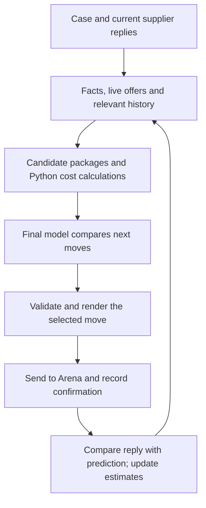

# How the negotiation system works

**Current policy:** `ksu-stability-contract-v2`, based on Ksu's argument pacing,
commercial concessions, management escalation and the contract/note evidence added
in `6be741d`, plus the closing guards from `08c5d10`. The current changes are checked
with automated contract tests, not a new paid Arena batch.

**Measured evidence:** the preceding ten-case Azure batch averaged **0.624269**,
with nine deals and one P05 no-deal. The subsequent capped GPT-6 P18 run scored
**0.466961**. These are separate code/configuration snapshots; neither measures
this revision. Ksu subsequently reported **0.721 on P18** in commit `6be741d`;
we integrated that evidence path without rerunning or independently verifying
the score. The README's **0.808 historical best mean** combines different
versions and attempts. See [Azure results](evaluation/azure-all-cases-20261011.md),
[capped GPT-6 results](evaluation/budget-recovery-20261011.md), and
[this revision's verification](evaluation/stability-main-20261011.md).

## Objective and authority

Reach an executable agreement that improves the buyer's **total cost**, subject
to the case's hard requirements. `arena_kit/cost.py` accounts for price, demand
shortfall, financing, freight, lateness, defects, tooling, index exposure and the
applicable relationship penalty. Some components are inactive in a particular case.
The official score compares opening-to-deal improvement against a hidden benchmark.
That benchmark is excluded from strategy inputs; no deal scores zero.

| Question | Responsible component | Limit |
|---|---|---|
| What is this package worth to the buyer? | Python cost calculation, with independent supplier-economic estimates | Known inputs are calculated; uncertain economics remain estimates. |
| How might the supplier react? | Actual replies and heuristic response scenarios | Sparse history does not produce calibrated probabilities. |
| Which move should we make? | Final model selects from a validated action/package menu | Python still determines the menu and policy restrictions. |
| Was it sent and what happened? | Arena client and append-only SQLite events | An attempted send is not proof that Arena received it. |

## Data flow

| Responsibility | Code |
|---|---|
| API, deadlines, live supplier state | `arena_kit/client.py`, `arena_kit/play.py` |
| Case, evidence and supplier memory | `agent.py`, `retrieval.py`, `storage.py`, `hollerau/intel.py` |
| Candidate generation and economics | `director.py`, `playbook.py`, `economics.py`, `sustainability.py`, `arena_kit/cost.py` |
| Model transport and compact decision context | `router.py`, `budget.py`, `lean_decision.py`, `prompt_context.py` |
| Decision contracts and continuation comparison | `contracts.py`, `continuation.py`, `decision_record.py` |
| Rendering and compliance | `director.py`, `communication.py`, `hollerau/compliance.py` |
| Feedback, reports and fingerprints | `feedback.py`, `beliefs.py`, `report.py`, `experiment.py` |
| Capped OpenAI spending | `spending.py`, `tools/run_gpt6.sh` |

Unqualified filenames are under `hollerau/analytical/`. `director.py` still spans
menu construction, coordination and execution; splitting it is a future refactor,
not a completed improvement.

## One turn

1. Receive replies and assemble currently available suppliers. In multi-supplier
   cases, refresh state before choosing or closing. State reads share a six-second
   deadline, including rate-limit waits; changed thread reads run concurrently.
   Known closures immediately remove live offers. An unread changed offer
   invalidates the old quote instead of allowing acceptance of obsolete terms.
2. Build validated packages using Ksu's concession rules, evidence, public-data
   anchors, optional proposer advice and term variants. Valid proposer packages
   remain eligible even when they differ from the heuristic price schedule.
3. Price packages using supplier economics **separate from** response beliefs.
   Observing willingness to accept may revise reservation estimates; it does not
   prove lower production costs or erase a relationship penalty.
4. The final model selects supplier, action, packages, evidence and a conditional
   plan. With useful moves remaining, early confirmation/acceptance must compare
   an actual available counter or question. The model can still close; no code
   forces continued negotiation. A prior stop condition is advisory. Ksu's closing
   policies exclude walking away from a valid deal that beats the estimated outside
   option and stop bargaining after two agreements. A better outside option remains
   selectable; these are menu policies based on estimates, not universal supplier laws.
5. Validate IDs, constraints, cited facts and the rendered message. Render every
   approved package and at most two model-selected claims. Existing evidence-backed
   automatic attachments may add another claim. Confirmation explicitly asks for
   a quote and is not an acceptance or purchase order. A failed rendering restores
   draft state, so unsent claims/questions are not consumed.
6. Record a send attempt, then mark it sent only after a confirmed API response.
   Unknown outcomes stay unconfirmed. A rejected acceptance may retry a new
   standing ID only when **all recorded terms are identical**; changed terms
   require a fresh decision. State recovery reads share a bounded deadline.
7. Record the actual reply and prediction error, then update appropriate estimates.
   A new decision budget requires new state during recovery. Terminal results
   survive post-result learning errors.

A refresh budget reduces one source of delay; it cannot guarantee that every
supplier remains available while another supplier or model takes time to respond.
Network races still require Arena's atomic acceptance check.

## Model modes and money

| Mode | Model work and failure behavior |
|---|---|
| Ksu's configured Azure/provider route | Optional proposer plus final decision; compact menus and existing validated-board fallback when configured. Fallback is explicitly logged and is not model approval. |
| Direct capped GPT-6 route | One final decision call; proposer skipped. Compact context, 2,048 output-token cap, request deadline within the shared turn budget, at most one bounded correction. No provider fallback when spending is capped. |

`Astra` in legacy event fields describes the decision role. The actual provider,
model ID, timing and token usage are recorded in model-call events; a role label
alone must not be reported as proof of which model ran.

The direct OpenAI ledger atomically reserves a conservative call ceiling before
sending, records returned usage and retains reservations for unknown outcomes.
Billing rejection blocks more calls. The same ledger must be reused across cases;
creating a new ledger would create a separate budget. Azure usage is not covered
by this OpenAI ledger. The remaining authorized budget for this improvement round
is **$0.500123** after **$0.499877** accounted previously; this revision adds no paid
calls or Arena sessions.

## Indexes, learning and records

- Buyer cost coefficients come from the case; they are not tuned to inflate scores.
- Supplier economics and response scenarios are distinct distributions. Response
  updates do not change cost weights. Estimates retain uncertainty.
- Pressure, concession pacing and final-offer rules are policies, not observed laws.
  There is no validated universal leverage index or trained multi-turn optimizer.
- The relationship factor is the case's economic penalty where applicable; it
  does not measure human respect. The LLM's neural weights are not trained here.
- SQLite stores events, attempt allowances and permitted practice cost feedback.
  Strategy retrieval excludes scores and hidden benchmark values.
- Decision record schema **2** includes continuation/exit context, the selected
  confirmation package, the linked full board and independent cost-model label.
  Raw returned decisions remain separate from normalized selections; old records
  are preserved rather than retroactively relabeled.

See [the decision contract](DECISION_CONTRACT.md). Credentials, raw databases and
negotiation traces stay outside Git. Entire links an authentic, scoped session
export with credentials and hidden benchmark fields redacted.
