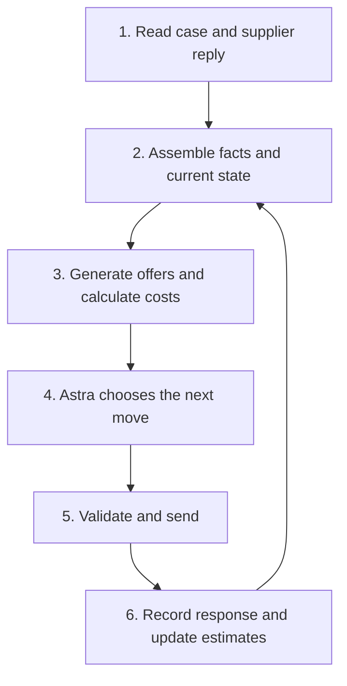

# How the negotiation system works

**Current runtime:** `astra-v10-traceable-plans`.
**Current validation scope:** one authorized P02 Arena session; no P18 or local tests.
The v9 baseline remains evaluated at `b7c1dbc`. V10 implements the timing and
linked-plan structure described here. See [the implementation record](evaluation/v10-traceable-plans.md)
and [the decision contract](DECISION_CONTRACT.md).

## The objective

Reach an executable agreement that improves the buyer's **total cost**, subject
to the case's hard requirements. A cheap unit price can be a poor deal if it buys
insufficient volume, late delivery, poor quality or costly index exposure.

`arena_kit/cost.py` adds price, uncovered demand, fallback risk, financing, freight,
lateness, defects, tooling, index effects and the applicable relationship penalty.
Some terms are zero or inactive in a case. The published score measures
opening-to-deal improvement relative to an unknown best-cost benchmark. That
hidden denominator is not an agent input. No deal scores zero. A score is not
our percentage discount or a probability of success.

Keep three questions separate:

| Question | Who answers it? | Status of the answer |
|---|---|---|
| How valuable is this deal to us? | Python cost calculation | Exact for known inputs; uncertain where supplier economics are estimated. |
| How might the supplier react? | Observed exchanges, explicit conditions and a response model | Estimates from sparse, selected history; not calibrated probabilities. |
| Which move should we make now? | Final Astra call choosing available action/package IDs | A strategic judgment, not an arithmetic result. |

## The six responsibilities

| Responsibility | Input → output | Current code |
|---|---|---|
| Arena connection | Case/messages → exchange; authorized action → Arena | `arena_kit/client.py`, `play.py`; practice logging in `hollerau/analytical/cli.py`. |
| Evidence and state | Public records + messages + memory → facts, current offers, estimates | `agent.py`, `retrieval.py`, `storage.py`, `hollerau/intel.py`. |
| Offers and economics | State → packages, validity, cost breakdowns and uncertainty | Astra proposer through `router.py`; Python `director.py`, `playbook.py`, `sustainability.py`, `arena_kit/cost.py`. |
| Strategic decision | Decision board → supplier, action, package IDs, conditional plan and reply | Final Astra call in `router.py`; schema in `contracts.py`; validation and linked outcomes in `decision_record.py`. |
| Execution | Selection → checked message or explicit failure | `director.py`, `communication.py`, `hollerau/compliance.py`. |
| Observation and audit | Actual reply/result → prediction error, evidence and revised estimates | `feedback.py`, `decision_record.py`, `beliefs.py`, `storage.py`; `report.py` displays plans beside outcomes. |

Unqualified filenames are under `hollerau/analytical/`. These are responsibility
boundaries, not newly created services. `director.py` currently spans offer
construction, decision coordination and execution; this coupling remains in code.

## One turn, precisely

1. Assemble live offers, remaining moves, public facts, supplier conditions and
   bounded same-case/supplier history. An old quote cannot be accepted now.
2. When time and status permit, call Astra to interpret the situation and propose
   up to three packages for one live supplier. A timeout yields no fresh proposals.
3. Python builds the menu from proposer packages, current terms, historical buyer
   moves and replies, term variants, public-data anchors and sustainability
   alternatives. It prices packages and adds advisory response estimates.
4. A separate Astra call chooses supplier and action: counter, ask, reply, confirm,
   accept or walk, subject to the available action menu.
5. Python validates IDs, full terms, constraints and rendered facts, then sends
   the selected action. Failed final authorization sends no substitute action.
6. Record the reply and update estimates. Completed practice cost components can
   refine supplier-economic estimates.

**Astra has the final choice within the menu. Python determines much of that
menu.** Calling Python only a calculator is misleading: it also generates
alternatives and applies strategic restrictions. Final Astra selection cannot
invent a new numerical package. The two Astra calls are different roles using
the same model, not two independent guarantees of correctness.

## What we retained from Ksu

Her changes introduced ambitious evidence-backed openings, reciprocal concessions,
less repetition, approval escalation with a supported commercial prospect, and
closing instead of countering explicit final offers. V9 extends these into supply,
capacity, quality, competitive RFQ and commercial routes. It also repairs jointly
invalid openings before generating variants and retains main's action/response
memory. See [the implementation record](evaluation/v9-category-playbooks.md).

The final-offer closing guard and standalone-question limit are **our policies**,
not buyer contractual constraints or universal facts about suppliers.

## What the numbers mean

| Family | Concrete examples | Source and use |
|---|---|---|
| Buyer priorities | Interest rate, EUR per late day, EUR per defect, relationship EUR per margin point | Given by the case. Do not tune the official cost coefficients to improve scores. |
| Supplier economics | Production cost EUR/unit, financing assumptions, sustainable margin | Evidence plus permitted practice cost feedback. Display uncertainty; acceptance does not prove profitability. |
| Supplier response | Reservation estimate `r`; payment, duration, lead, quality, capacity, index and volume sensitivities | Heuristic priors updated from exchanges; advisory supplier preferences, not buyer weights. |
| Strategy choices | Anchor percentages, concession sequence, final-offer rule | Developer/Astra policy assumptions to evaluate. |
| Engineering limits | 55-second shared internal budget; proposer up to 20 seconds; final request cap 30 seconds; 24 anchor packages | Limits affecting which information/options reach the decision-maker. |

There is no validated universal pressure index. Behavior currently uses 64 weighted
scenarios; supplier economics uses a separate distribution. Astra's neural weights
are not trained. Buyer preference weights are not learned. In the challenge,
relationship is a specified economic penalty where applicable, not a measurement
of how much a person respects us.

For leverage, first expose concrete facts: cost of valid alternatives, unmet demand,
feasible suppliers, and the buyer cost of each concession. How much a supplier
needs us remains an estimate unless supported by evidence. A single number can
hide these distinctions.

## What is stored

SQLite remains at private `hollerau/logs/analytical.sqlite`.

| Table | Purpose |
|---|---|
| `events` | Append-only cases, evidence, boards, decisions, exchanges, estimates and results. |
| `attempts`, `allowances` | Reserve starts before HTTP and track bounded Arena use. |
| `cost_feedback` | Permitted completed-practice cost observations for matching supplier/case/context. |
| `learned_models` | Legacy audit rows; current Astra behavior is reconstructed from raw matching exchanges. |

Audit records can contain scores. Strategy retrieval excludes scores and hidden
benchmark fields. A supplier response, a prediction and an evaluation are different
kinds of evidence. Credentials and raw databases stay out of Git.

## What the latest evidence says

[Six v9 sessions](evaluation/v9-arena-results.md) produced three improvements over
previous bests, one tie and two declines. P08 never started after the request to
stop. Frozen runtime source hashes remained unchanged.

**16 of 19 proposer calls timed out; all 20 final calls succeeded.** The final
choice often lacked fresh first-call proposals. This is an observed execution
problem, not proof that it caused every poor score.

Multiple strategy changes, memory integration and timing changes shipped together.
There was one new session per case, with no matched baseline rerun. Effects of
individual changes cannot be separated from different histories or model/supplier
variation. Comparing one new run with the best of several old runs also favors
the historical best. Report this comparison without claiming causation.

## Implemented structure and remaining limits

V10 requires a structured **move → predicted reply → conditional next move →
observed prediction error** chain. `decision_record.py` validates plans, links them
to full boards and records response/price mismatches. The next decision receives
that mismatch and must explain its revision. Conditional actions are plans, never
automatically executed promises.

The old acceptance/walkout subtotal is explicitly labeled as a partial value;
it is not a full expected value that silently assigns no improvement to counters.
Astra must plan the counteroffer branch. There is still no calibrated multi-turn
optimizer, learned buyer weights or guarantee that a valid plan is strategically good.

`budget.py` owns deadline allocation. `prompt_context.py` losslessly tabulates and
deduplicates prompt data, verifies reconstruction before sending, and preserves all
offers, source values and IDs. `experiment.py` fingerprints code, public data and
initial memory. The practice runner supports stopping after the current session
without changing its allowance. [The decision contract](DECISION_CONTRACT.md)
identifies remaining limits.
