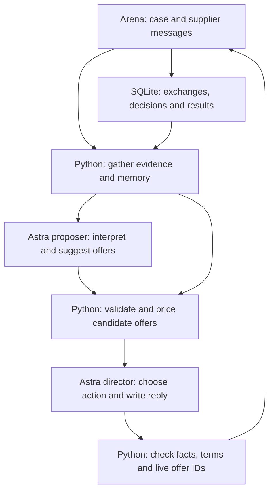

# Current negotiation architecture

The current runtime is `astra-v9-category-playbooks`, documented in
[the v9 implementation](evaluation/v9-category-playbooks.md). It integrates Ksu's
strategy with the v8.3 memory described here. The pipeline remains the same, with
category-specific plans, jointly feasible opening candidates and a 45-second
internal budget (instead of 35). The measured weaknesses and scores below refer
to v8.3 at `7c646fdebf59878234a8974a684804a78e768998`; they are not v9 results.

## Responsibilities

| Layer | Main files | Current responsibility |
|---|---|---|
| Arena connection | `arena_kit/client.py`, `play.py` | Receive cases and messages, enforce the interaction protocol, send actions, manage deadlines. |
| Coordination | `hollerau/analytical/agent.py`, `cli.py` | Initialize case state and estimates, gather inputs, invoke the final-authority path, record completed outcomes. |
| Evidence and memory | `retrieval.py`, `storage.py` | Retrieve public facts, forecasts and cost drivers; reconstruct earlier buyer moves with their supplier responses and negotiation stage. |
| Model calls | `router.py`, `contracts.py` | Call Astra with separate proposer/director instructions and structured output contracts. |
| Offer evaluation | `director.py`, `sustainability.py`, `arena_kit/cost.py` | Construct feasible candidates and compare total costs, including applicable non-price costs and uncertainty. |
| Behaviour estimates | `beliefs.py`, `feedback.py`, `preferences.py`, `deliberation.py` | Update uncertain supplier estimates and summarize acceptance/counter/walkout evidence; expose advisory continuation calculations. |
| Execution checks | `director.py`, `communication.py`, `hollerau/compliance.py` | Validate the selected action, factual claims and complete terms; accept only a current offer; render and send the selected reply. |

Paths in the table are under `hollerau/analytical/` unless another directory is
shown. Some planning and legacy-agent modules remain for other modes; their
presence does not mean they choose actions on the default final-authority path.

## One decision, in practice

1. Read current supplier messages, valid negotiating terms, public evidence and
   up to ten retrieved same-case/supplier episodes. Historical quotes are evidence,
   not currently executable deals.
2. Ask the proposer Astra call to interpret the evidence and suggest up to three
   complete offers. If this call fails, there are no fresh proposer offers.
3. Build a decision board from valid proposer offers, current and previous terms,
   historical buyer proposals and supplier replies, plus generated term variants.
   Python computes cost estimates and comparisons for these packages.
4. The director Astra call selects a counteroffer, question, confirmation,
   acceptance or walk-away action and writes any supplier-facing reply.
5. Python checks the selected IDs, allowed terms and facts. It does not replace
   the choice with its own strategic winner. Invalid or missing final authorization
   stops the action instead of silently accepting a deal.
6. Store the action and subsequent supplier response. Update behavioural evidence;
   completed practice cost breakdowns can refine supplier-economics estimates.

The director chooses package IDs from the board. It cannot invent a fresh
arbitrary numerical package at the final step. Thus Astra has final authority
over the available actions, while Python and the proposer determine the menu.

## What is and is not learned

- **Remembered:** earlier messages, preceding buyer proposals, supplier responses,
  negotiation stage, final decisions and observed practice results.
- **Updated:** uncertain supplier-response estimates and, where applicable,
  supplier-cost estimates informed by observed practice cost components.
- **Given by the case:** buyer priorities and the published cost coefficients for
  payment, delivery, quality, index exposure and relationship effects. Applicable
  components depend on the case and terms; they are not all active everywhere.
- **Not trained:** Astra's model weights. There is no learned universal pressure
  index and no demonstrated mechanism that discovers new buyer preference weights.

For the competition, the objective is positive total-cost improvement over the
opening offer, subject to constraints. Relationship is represented by the case's
cost model when applicable; it is not a measurement of how a real person respects
us after an email.

## Structural weaknesses supported by the latest pair

The system is detailed at evaluating proposed deals and less explicit at planning
negotiation sequences. Historical action-response links exist, but a candidate
does not include a structured forecast of the supplier's next quote and our
subsequent response. The numerical continuation calculation gives no additional
improvement value to a future counteroffer; Astra must infer that from prose and
history. Those estimates are explicitly uncalibrated.

The architecture also asks two sequential model calls to share a 35-second
internal decision budget. The Arena runner allows 60 seconds per move, including
other work. In the latest P18 run every proposer call timed out at about 11.2
seconds; the final director still chose from existing packages. Final requests
across P02/P18 contained roughly 34,000–75,000 input tokens. Much of that board is
cost detail and repeated context, making prioritization expensive.

P18's historical EUR 5.25 fixed-price opening was available, but Astra chose the
later EUR 5.60/EUR 5.50 indexed menu again. Availability alone did not change the
decision. P02's observed cost forecast was close to the actual result, yet the
negotiation score remained low. These observations do not prove that any one
untried opening would score better.

## Recommended next design, not implemented

Use a compact case state and explicit negotiation plans: proposed move, supporting
evidence, plausible supplier replies, our next move, and a stop condition. Price
those plans' concrete offers with Python and preserve uncertainty instead of
pretending sparse response estimates are precise. Give the final decision a
reliable time allocation and keep useful historical actions visible without
selecting a winner through arbitrary Python truncation.

Measure whether this changes actual choices and responses on P02/P18. A stronger
model or a larger prompt alone is not evidence of improvement. The latest measured
scores remain P02 **0.254765** and P18 **0.273018**; see
[the Arena report](evaluation/v83-arena-results.md).
